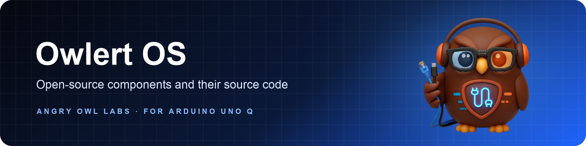

  

  <b>The open-source side of Owlert OS.</b> 
  Every third-party component we ship, its licence, and the exact source code behind it.

  
  
  
  

---

## What this is

[Owlert](https://owlertos.com) watches the airwaves around your home or business and tells you when someone tries to jam
or knock your wireless cameras, alarms and locks offline. **Owlert OS** is the operating system that runs on the Owlert,
built for the Arduino® UNO Q.

Owlert OS is built on a lot of great open-source software: Debian, the Linux kernel, the Arduino ESP32 core and more.
Our own Owlert software (the Owlert services, their settings and the image scripts) belongs to Angry Owl Labs LLC. Every
other part keeps its own licence, and nothing we do limits the rights those licences give you.

This repository is where we keep our side of those licences:

| | |
|---|---|
| 📦 **Package lists** | Every package in every release, with its version, source package and licences ([`releases/`](releases/README.md)). |
| 🐧 **Kernel and modules** | The exact kernel commit each release was built from, and the modules we add. |
| 🔧 **Tools and firmware** | esptool, OpenOCD and the ESP32 firmware libraries, with their versions. |
| 📝 **Licence texts** | The Qualcomm and MediaTek firmware licences and our notices ([`LICENSES/`](LICENSES)). |
| 💾 **Source archives** | The complete corresponding source of the GPL and LGPL parts, attached to each [GitHub release](../../releases). |
| ✉️ **Written offer** | For at least three years after each release, the source on request, free ([`WRITTEN-OFFER.md`](WRITTEN-OFFER.md)). |

## Releases

| Release | Type | Distributed | Package list |
|---|---|---|---|
| `OHOS_v2.0.1.0` image r6 | Flashable image | October 2026 | [`releases/OHOS_v2.0.1.0-r6`](releases/OHOS_v2.0.1.0-r6) |
| `OHOS_v2.0.1.0` images r1 to r5 | Flashable image | October 2026 | [`releases/`](releases/README.md) |
| Update bundles, `v1.0.2.1` to `OHOS_v2.0.1.0` | Device updates | June to October 2026 | [`releases/update-bundles`](releases/update-bundles) |

## Get the source

1. Pick your release in [`releases/`](releases/README.md). The release name is in Settings on your Owlert, and on the
   portal's device page.
2. Download its source archives from the matching [GitHub release](../../releases).
3. Missing something, or prefer a download link by email? Write to **support@owlertos.com** with the subject
   "Owlert OS source request". It's free.

## What isn't here

- **Our own Owlert software.** It runs alongside the open-source parts as separate programs and isn't open source.
- **The Qualcomm and MediaTek firmware itself.** Those are binary-only blobs we redistribute unmodified under their own
  licences (texts in [`LICENSES/`](LICENSES)).
- **Anything private.** No accounts, keys, device data or internal systems, ever.

## Support us

Owlert is made by Angry Owl Labs. If Owlert OS is useful to you, you can support our work with crypto. Thank you! 💙

<table>
  <tr>
    <td></td>
    <td><b>Bitcoin</b></td>
    <td><code>bc1qz7xaxn5czspya8gp2r9060sa5vcthrvyug765e</code></td>
  </tr>
  <tr>
    <td></td>
    <td><b>Ethereum</b> ETH, USDC or USDT</td>
    <td><code>0x5B3819D1018012065964FCcEb8481C62Ce2a48d2</code></td>
  </tr>
  <tr>
    <td></td>
    <td><b>Solana</b></td>
    <td><code>H4kTscJjpZrawJWBSSGfEXM8hwDXxB1GPGFCia75mgTJ</code></td>
  </tr>
  <tr>
    <td></td>
    <td><b>Zcash</b></td>
    <td><code>t1aBNYFx4uMdjK9tgb62pWxQp6g5A7T8r8x</code></td>
  </tr>
</table>

Send only on the network named beside each address (USDC and USDT on Ethereum). Crypto sent on another network can't be recovered.

## Trademarks

Arduino® is a trademark of Arduino S.r.l. Qualcomm is a trademark of Qualcomm Incorporated. Linux® is the registered
trademark of Linus Torvalds. Debian, MediaTek, Espressif and Tailscale are trademarks of their owners. Owlert OS is made
by Angry Owl Labs LLC for the Arduino UNO Q; it isn't made or endorsed by Arduino or Qualcomm.

Made by <a href="https://owlertos.com">Angry Owl Labs</a> · Owlert, the early warning for wireless security

